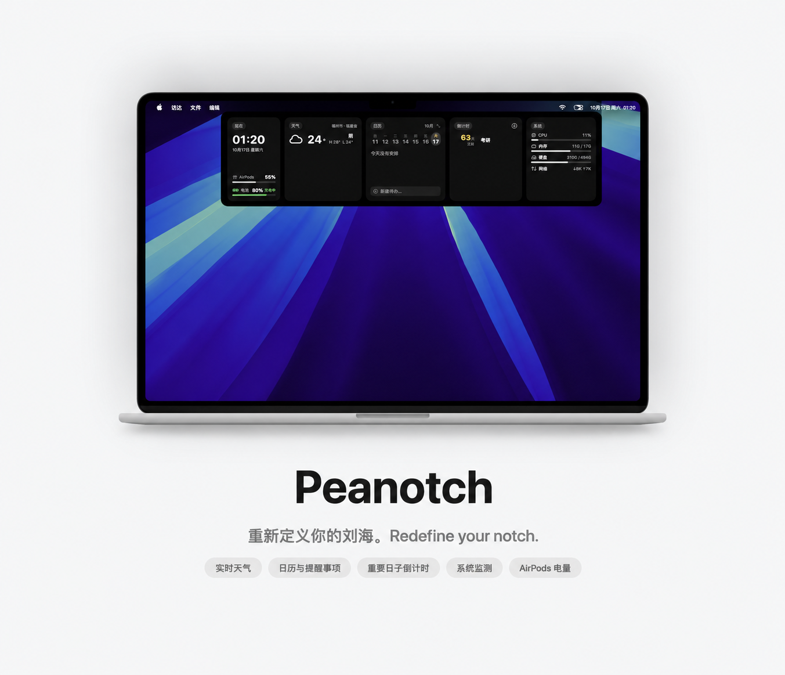

<div align="center">



# 🥜 Peanotch

**一个极简的 macOS 刘海（Notch）小应用**

平时在刘海区域显示时钟，鼠标悬停自动展开显示日期等信息。

</div>

## 功能

- **刘海仪表盘** — 黑色圆角胶囊平时在刘海区域显示温度与电量，展开后显示完整仪表盘：时钟、天气、日历、倒计时、系统监测
- **NBA 比赛日程** — 在设置中开启并选择主队，比赛按开球时间并入日历日程；赛程每天更新一次，主队比赛进行中时每 2 分钟刷新比分（数据来自虎扑）
- **日历与提醒事项** — 读取系统日历与提醒事项（EventKit），支持在刘海内展开完整月历、点选日期、直接创建提醒
- **重要日子倒计时** — 自定义重要日子，支持在卡片内双击直接编辑、内联新建
- **系统监测** — CPU、内存、硬盘、网速、电池健康，以及连接中 AirPods 的电量
- **展开方式可选** — 点击或鼠标靠近展开；弹簧动画过渡，平滑不闪烁
- **设置** — 语言（中/英）、展开方式、温度单位、24 小时制、触控板震动反馈
- **菜单栏控制** — 通过菜单栏的 🥜 图标可以显示/隐藏刘海、退出应用
- **常驻所有空间** — 跟随每个桌面空间与全屏应用显示

## 环境要求

- macOS 14.0 或更高版本
- Xcode 16 或更高版本（用于编译）

## 运行

**方式一：Xcode**

```bash
open Peanotch.xcodeproj   # 然后在 Xcode 中按 Cmd + R
```

**方式二：命令行**

```bash
xcodebuild -project Peanotch.xcodeproj -scheme Peanotch -configuration Debug -derivedDataPath build build
open build/Build/Products/Debug/Peanotch.app
```

## 路线图（Ideas）

- [ ] 正在播放（Now Playing）媒体信息
- [ ] 文件暂存架（File Shelf）
- [ ] 更多运动项目赛程（足球等）
- [ ] 拖拽调整宽度

## 致谢

Peanotch 的创意受 [Sapphire](https://github.com/cshariq/Sapphire) 启发（一个功能丰富的开源
macOS 刘海应用，AGPL-3.0 协议）。Peanotch 的所有代码均为原创实现，与本仓库无代码关联。

## 许可证

[MIT](LICENSE)
